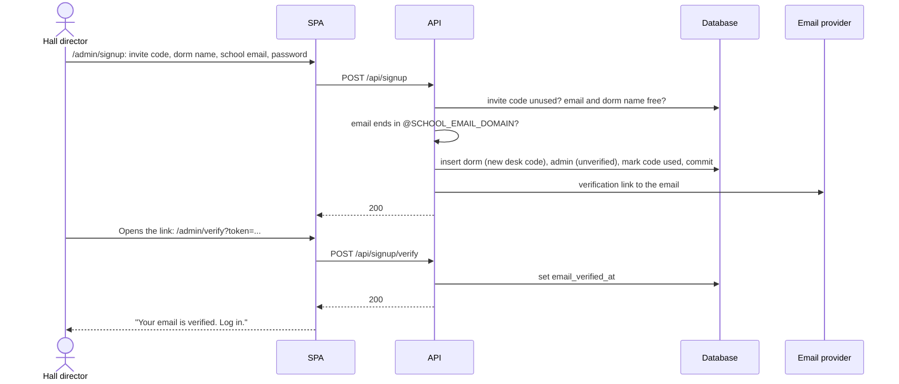
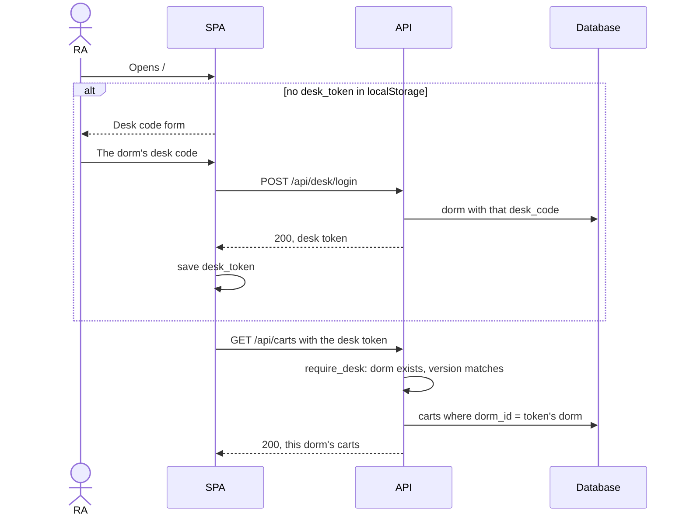
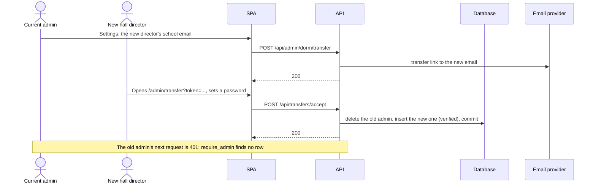

# Dorms design

**Area:** Dorms, admin accounts, and desk codes (no GitHub issue yet)

> **Realizes:** `OI-17`, `OI-18`, and the 2026-10-29 answer to `OI-6`; `BR-dorm-owns-carts`, `BR-one-admin-per-dorm`, `BR-admin-signup`, `BR-admin-transfer`, `BR-desk-code`, `BR-cart-number-unique-per-dorm`
> **Depends on:** `BR-store-utc`, `BR-site-timezone`, `BR-cart-admin-only`, `KD-no-migrations`, `KD-staging-git-branch`
> **See:** [business rules](../requirements/business-rules.md), [architecture](architectural-design.md), [open issues](../requirements/OPEN-ISSUES.md), [notifications.md](notifications.md)
> **Designed against:** `a9bc524`

**Status:** Draft. Nobody builds from it until it is merged.

---

## Overview

Today the app serves one set of carts to one shared admin password and an open desk. This design
lets several dorms on one campus use the same app, each with its own carts and checkouts, and
neither able to see the other's.

- A **dorm** is a row in a new `dorms` table. Carts point at their dorm with `dorm_id`; a
  checkout belongs to a dorm through its cart. Every dorm shares the same tables. Rejected: a
  table per dorm (see [Key decisions](#key-decisions)).
- Each dorm has **exactly one admin**, with a personal account (school email and password).
- An admin **signs up** with an invite code and a school email address verified by a link, and
  creates the dorm in the same step.
- **RAs** enter the dorm's **desk code** once per device. The device then gets a desk token that
  keeps working until the admin changes the code.
- The **site timezone stays app-wide**. All dorms are on one campus, so `OI-6` is reversed:
  a dorm admin can't change it.

Out of scope: password reset (`OI-24`), deleting a dorm (`OI-25`), and anything a person outside
the school can do.

## Components & classes

**API**

- `app/models.py` (**changed**): new `Dorm`, `Admin`, `InviteCode`; `Cart` gains `dorm_id`. See
  [Data model](#data-model).
- `app/auth.py` (**changed**):
  - `hash_password()`, `verify_password()`: hash with `bcrypt` (new dependency) instead of
    comparing against `ADMIN_PASSWORD`, which is removed.
  - `create_admin_token(db_admin)`: claims `sub: "admin"`, `admin_id`, `dorm_id`, 8 hours.
  - `create_desk_token(db_dorm)`: claims `sub: "desk"`, `dorm_id`, `desk_code_version`, 30 days.
  - `require_admin` (**changed**): decodes the token, then loads the `Admin` row. A missing row
    (the dorm was transferred) is `401`. Returns the row, so every admin route reads
    `db_admin.dorm_id`.
  - `require_desk` (**new**): decodes a desk token and loads the `Dorm`. A version that doesn't
    match `desk_code_version` (the code was changed) is `401`. Returns the dorm.
  - `create_link_token(purpose, ...)` and `read_link_token(...)`: short-lived signed tokens for the
    verification and transfer links, `sub: "verify"` or `sub: "transfer"`, 24 hours.
- `app/routers/signup.py` (**new**): public signup, email verification, and accepting a transfer.
- `app/routers/desk.py` (**new**): `POST /api/desk/login`, trading a desk code for a desk token.
- `app/routers/carts.py` (**changed**): list, checkout, and return take `require_desk` and filter
  by its `dorm_id`. A cart in another dorm is `404 "Cart not found"`, the same as a missing one.
- `app/routers/admin.py` (**changed**): every query filters by `db_admin.dorm_id`. New dorm routes
  (desk code, transfer). `admin_login` takes an email. `update_timezone` is removed.
- `app/email.py` (**new**): `send_email(to, subject, body)`, a `POST` to Brevo's transactional
  email API with `httpx` (already a dependency), from the address in `EMAIL_FROM`. Injected as a
  FastAPI dependency so tests replace it, the same way as `get_db`.
- `app/routers/settings.py` (**reused**): `GET /api/settings` stays public and unfiltered.
- No operator tool. The developer makes invite codes and changes the site timezone in Neon's
  SQL editor; see [Operator tasks](#operator-tasks).

**SPA**

- `CartList.jsx`, `CheckoutForm.jsx` (**changed**): send the desk token. With no token, or after a
  `401`, show a "Desk Code" form instead of the list.
- `frontend/src/desk.js` (**new**): keeps the desk token in `localStorage` as `desk_token`.
- `AdminSignup.jsx`, `AdminVerify.jsx`, `AdminTransferAccept.jsx` (**new**): `/admin/signup`,
  `/admin/verify`, `/admin/transfer`. The last two read a token from the link's query string.
- `AdminLogin.jsx` (**changed**): an email field.
- `AdminSettings.jsx` (**changed**): the timezone picker goes; it shows the dorm name, the desk
  code with a "Change Desk Code" button, and the transfer form.

## Sequence

### Signing up a dorm



The invite code is used up at signup, not at verification, so it can't be spent twice by two
people racing. A signup that is never verified wastes one code; the developer hands out another.

### An RA opens a desk device



When the admin changes the desk code, `desk_code_version` goes up by one. The next request from
every device with the old token is `401`, and the SPA shows the desk code form again.

### Handing the dorm to a new hall director



The link proves the new director owns the address, so the new account starts verified. Whether
the new director also needs an invite code is `OI-23`; this design assumes not.

## API contract

Paths under `/api/admin` take an admin token. Every error is `{"detail": "..."}`.

| Endpoint | Caller | Request | Success | Errors |
|---|---|---|---|---|
| `POST /api/signup` | Anyone | `invite_code`, `dorm_name`, `email`, `password` | `200`; a verification email is sent | Unknown or used code: `400 "Invite code is not valid"`. Not the school domain: `400 "Email is not a school address"`. Taken: `400 "Email is already registered"`, `400 "Dorm name is already taken"`. Malformed: `422`. |
| `POST /api/signup/verify` | Anyone with the link | `token` | `200` | Bad or expired: `400 "Link is not valid or has expired"` |
| `POST /api/admin/login` (**changed**) | Anyone | `email`, `password` | `200`, admin token | Wrong either: `401 "Incorrect email or password"`. Not verified: `403 "Email is not verified"`. |
| `POST /api/desk/login` | Anyone | `desk_code` | `200`, desk token | `401 "Desk code is not valid"` |
| `GET /api/carts` (**changed**) | Desk token | | `200`, the dorm's carts | No or bad token, or the code was changed: `401` |
| `POST /api/carts/{cart_id}/checkout`, `/return` (**changed**) | Desk token | as today | as today | as today, plus `401`; another dorm's cart: `404 "Cart not found"` |
| `GET /api/settings` | Anyone | | `200`, `timezone` | |
| `GET /api/admin/dorm` | Admin token | | `200`, `name`, `desk_code` | `401` |
| `POST /api/admin/dorm/desk-code` | Admin token | | `200`, the new `desk_code` | `401` |
| `POST /api/admin/dorm/transfer` | Admin token | `email` | `200`; a transfer email is sent | Not the school domain: `400 "Email is not a school address"`. Already an admin: `400 "Email is already registered"`. `401`. |
| `POST /api/transfers/accept` | Anyone with the link | `token`, `password` | `200` | Bad or expired: `400 "Link is not valid or has expired"`. The old admin already left (a second transfer won): same `400`. |
| Every other `/api/admin/...` route (**changed**) | Admin token | as today | as today, only this dorm's rows | A row in another dorm: `404`, the same as a missing one |
| `PUT /api/admin/settings/timezone` (**removed**) | | | | |

Another dorm's cart or checkout is `404`, never `403`, so an admin or desk can't learn which ids
exist elsewhere.

## Key decisions

**Shared tables with a `dorm_id`, not a table per dorm.** A dorm is data, not schema: twelve carts
in one dorm and forty in another are just rows. Rejected: a table per dorm, which means creating
tables at signup, building every query from a table name, and repeating each schema change once per
dorm by hand on Neon (`KD-no-migrations`). Cost: every query must filter by `dorm_id`, and a
forgotten filter leaks another dorm's data. The tests in [Tests](#tests) check each route for it.

**Personal admin accounts, one per dorm.** Asked for on 2026-10-29 (`OI-18`). The database
enforces "one" with a unique `admins.dorm_id`. Rejected: a password per dorm, which can't tell
who is logged in and can't be handed over without telling the old holder. Rejected: several
admins per dorm, not wanted. Cost: signup, verification, and transfer flows, and an email provider
before #17 needs one. This supersedes `KD-shared-admin-password`.

**Signup needs an invite code and a verified school email.** The invite code keeps strangers out;
the school domain (`SCHOOL_EMAIL_DOMAIN`, one value, since all dorms are on one campus) and the
verification link keep a leaked code from making an account under someone else's address.

**A desk code per dorm, entered once per device.** RAs still don't log in as people
(quality goal 2), but someone off campus can no longer check out a dorm's carts
(`RISK-open-desk-api`). The code is random, 8 characters from an alphabet without look-alikes
(no `0`/`O`, `1`/`I`), generated by the API. Codes are unique across dorms, so the code alone says
which dorm a device is for and the RA never picks one.

**The desk code is stored in plain text.** The admin has to be able to read it again to tell a new
RA. Rejected: storing a hash, which means the admin can only ever see a code once, at the moment
it's changed. Cost: anyone who reads the database can use the desk. They could already read every
checkout there, so it exposes nothing new.

**Changing the desk code signs out every device.** The token carries `desk_code_version`, checked
on each request. Rejected: tokens that only expire with time, which leave a leaked code usable
for the whole 30 days.

**Desk tokens last 30 days.** Long enough for a whole move-in period on one login. Changing the
code is how a device is cut off early.

**`require_admin` reads the admin's row.** One extra query per admin request, so that a
transferred-away admin is cut off at once rather than when their 8-hour token expires.

**One site timezone for the whole app.** All dorms are on one campus (answered 2026-10-29), so
`OI-6`'s per-organization timezone isn't needed. The `settings` row and `get_site_timezone()` stay.
Only the developer changes it, in Neon's SQL editor ([Operator tasks](#operator-tasks)). Cost: if a
dorm in another timezone ever joins, this design is revisited.

**Single-use invite codes, made in Neon's SQL editor.** Answered 2026-10-29 (`OI-21`). One
code makes one dorm, so a leaked code is worth one signup at most. Rejected: a script, a Render
shell, or a secret-protected API route. Each is something to build and protect for a task done a
few times a year. Cost: the developer writes SQL against production by hand, so the statements
are kept in [Operator tasks](#operator-tasks) and rehearsed on the `staging` branch first.

**Email through Brevo's API, from one verified sender address.** Answered 2026-10-29 (`OI-22`).
Render's free plan has blocked outgoing SMTP (ports 25, 465, 587) since 2025-09-26, so the app
must send over an HTTPS API. Brevo's free plan allows about 300 emails a day and, according to
third-party guides, needs only one verified sender address, not a domain. Rejected: Gmail SMTP
(blocked on Render). The Gmail API, which needs a Google Cloud project and an OAuth refresh token.
Buying a domain, or paying Render $7 a month, both against quality goal 3. Cost: without a
domain, Brevo may rewrite the sender to `@brevosend.com`, and school mail filters may mark the
email as spam. Signup and transfer pages tell people to check their spam folder.

**Start fresh in production.** The existing carts and checkouts are deleted when this ships
(answered 2026-10-29). The tables are dropped and `create_all` builds the new ones, so there is no
manual column change on Neon.

## Data model

| Table | Column | Notes |
|---|---|---|
| `dorms` (**new**) | `id` | |
| | `name` | unique; the name the admin typed at signup |
| | `desk_code` | unique; plain text |
| | `desk_code_version` | integer, starts at 1, goes up on each change |
| | `created_at` | `utc_now()` |
| `admins` (**new**) | `id` | |
| | `dorm_id` | foreign key to `dorms`, **unique**, not null |
| | `email` | unique, stored lowercase |
| | `password_hash` | `bcrypt` |
| | `email_verified_at` | null until verified |
| | `created_at` | `utc_now()` |
| `invite_codes` (**new**) | `id` | |
| | `code` | unique |
| | `created_at` | `utc_now()` |
| | `used_at` | null until used |
| `carts` (**changed**) | `dorm_id` | **new**; foreign key to `dorms`, not null |
| | `cart_number` | no longer unique on its own; unique together with `dorm_id` |
| `sessions` | | No change. A checkout's dorm is its cart's. |
| `settings` | | No change. |

`invite_codes` doesn't record which admin used a code, since a transfer deletes the admin it would
point at.

## Operator tasks

Run in Neon's SQL editor, on the `staging` branch first. Timestamps are naive UTC
(`BR-store-utc`).

Make an invite code, and copy the code it returns:

```sql
INSERT INTO invite_codes (code, created_at)
VALUES (upper(substr(md5(random()::text), 1, 10)), now() AT TIME ZONE 'utc')
RETURNING code;
```

List unused codes:

```sql
SELECT code, created_at FROM invite_codes WHERE used_at IS NULL ORDER BY created_at;
```

Change the site timezone. The value must be a valid IANA name; nothing checks it here, so an
invalid name breaks every page that shows a time:

```sql
INSERT INTO settings (key, value) VALUES ('timezone', 'America/Chicago')
ON CONFLICT (key) DO UPDATE SET value = EXCLUDED.value;
```

## Reuse & cross-cutting

- `get_db` and `app.dependency_overrides`, for the database and now for `send_email`.
- `utc_now()` for every new timestamp ([8.2.1](architectural-design.md#821-time-and-time-zones)).
- `require_admin` stays applied at the admin router level, so a new admin route can't skip it
  ([8.1](architectural-design.md#81-security)). The public carts router gets `require_desk` the
  same way, except `GET /api/settings`, which stays on its own router.
- `_get_cart_or_404` gains a `dorm_id` argument, so the dorm check is in one place per router.
- `close_session()` is unchanged; its callers have already checked the dorm.

## Tests

`tests/conftest.py` overrides `send_email` with a fake that records messages, so a test can read
the link out of the "sent" email. Fixtures: `invite_code`, `verified_admin` (with `admin_headers`
for its token), `desk_headers`, and `other_dorm` with its own cart and checkout.

| Flow | Level | Asserts |
|---|---|---|
| Signup | integration | Creates the dorm and an unverified admin, uses the code, sends one email |
| Signup, bad code | integration | Unknown and used codes: `400` |
| Signup, wrong domain | integration | `400`, nothing created, code not used |
| Signup, taken | integration | Email or dorm name already used: `400` |
| Verify | integration | The link's token sets `email_verified_at`; a tampered or expired one is `400` |
| Login before verifying | integration | `403` |
| Login | integration | Wrong password and unknown email give the same `401` |
| Desk login | integration | Right code gives a token; wrong code `401` |
| Desk code change | integration | Old desk token `401`, new code works |
| Desk isolation | integration | Listing, checking out, and returning `other_dorm`'s cart: list excludes it, the others `404` |
| Admin isolation | integration | Every admin route against `other_dorm`'s cart or checkout: `404`, and lists exclude its rows |
| Cart numbers | integration | Two dorms can each have cart `"1"`; the same dorm can't twice |
| One admin per dorm | integration | A second admin row for the same dorm fails at the database |
| Transfer | integration | The new admin can log in; the old admin's token is `401` |
| Transfer link reuse | integration | Accepting the same link twice: second is `400` |
| Timezone route gone | integration | `PUT /api/admin/settings/timezone` is `404` or `405` |
| No token | integration | Every desk and admin route: `401` |

## Changes to the architecture-of-record

When this ships:

- [3](architectural-design.md#3-context-and-scope) and [5.1](architectural-design.md#51-containers):
  the email provider is no longer only planned for #17; signup needs it.
- [5.2](architectural-design.md#52-use-case-areas-and-components): a Dorms component (signup,
  transfer, desk code); Auth changes to accounts and desk tokens.
- [8.1](architectural-design.md#81-security): rewritten for accounts, desk tokens, and the
  `dorm_id` filter as the boundary between dorms.
- [9](architectural-design.md#9-architecture-decisions): `KD-shared-admin-password` superseded by a
  `KD-admin-accounts` decision; quality goal 2 notes the desk code.
- [11](architectural-design.md#11-risks-and-technical-debt): `RISK-open-desk-api` mitigated; a new
  risk for a forgotten `dorm_id` filter.

## Rollout

1. Merge into `staging`. On the Neon `staging` branch, drop `sessions`, `carts`, and `settings`,
   and run the app locally so `create_all` builds the new tables. Sign up a test dorm end to end.
2. Release to `main`. Drop the same tables on Neon `production` right before the deploy. This
   deletes every cart and checkout there.
3. In Brevo, create the free account, verify the sender address, and make an API key.
4. Set the new environment variables on Render (`SCHOOL_EMAIL_DOMAIN`, `BREVO_API_KEY`,
   `EMAIL_FROM`, and the SPA's URL for links) and remove `ADMIN_PASSWORD`.
5. Make the first invite code ([Operator tasks](#operator-tasks)) and sign up your own dorm with
   a school address. Check that the verification email arrives, and whether it's in spam.

The API and SPA change together. Between Render's and Vercel's deploys, the old SPA gets `401`
from every desk route, so deploy outside move-in days.

## Open questions & risks

- Risk: verification emails land in school spam, since there's no domain behind the sender
  (`OI-22`). If they do, buying a domain and verifying it in Brevo is the fix; nothing else in this
  design changes.
- Risk: Brevo's free plan was checked only through third-party guides on 2026-10-29. Confirm the
  single-sender and 300-a-day limits in Brevo's own docs before building `app/email.py`.
- `OI-23`: whether a transfer also needs an invite code.
- `OI-24`: password reset. Until it exists, a dorm whose admin forgets their password is fixed by
  hand in the database.
- `OI-25`: deleting a dorm.
- `OI-10` gets easier: with one campus timezone, a checkout doesn't need to remember its zone
  unless the setting changes.
- Risk: a route that forgets the `dorm_id` filter shows another dorm's data. The isolation tests
  are the guard.
- Risk: guessing a desk code. 8 characters from about 30 symbols is about 6.5 * 10^11 codes, and
  the API on Render's free plan answers a few requests a second, so guessing isn't practical.
  No rate limit is planned.
