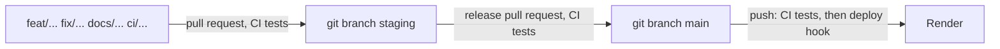

# Environments design

**Area:** Which database each place the app runs uses, and how a change reaches production

> **Realizes:** `KD-one-database-url`, `KD-develop-on-staging-database`, `KD-production-url-only-on-render`, `KD-tests-own-database`, `KD-staging-git-branch`
> **Depends on:** `KD-neon-database`, `KD-no-migrations`
> **See:** [architecture](architectural-design.md) sections 7 and 9, [open issues](../requirements/OPEN-ISSUES.md)
> **Designed against:** `4289053`

**Status:** Accepted on 2026-10-16. Built, except the Postgres test database in CI, which is on
branch `ci/postgres-tests`.

---

## Overview

The app runs in three places: on Render for real users, on a developer's laptop, and inside the
test suite. The code is the same in all three. Only `DATABASE_URL` changes, and each place sets it
from its own source. Before 2026-10-16 the laptop's `.env` held production's URL, so running the
app locally and clicking around changed real carts and checkouts. This design gives every place
its own database and adds a `staging` git branch where changes wait before they deploy.

## Environments

| Where it runs | `DATABASE_URL` comes from | Database | Used for |
|---|---|---|---|
| Production | Render's environment settings | Neon branch `production` | Real users |
| Laptop | `.env` in the repository root (gitignored) | Neon branch `staging` | Running the app by hand, rehearsing schema changes |
| Tests | `tests/conftest.py`, which overrides `.env` | A SQLite file, emptied for every test | `pytest`, locally and in CI |

The word "staging" names two unrelated things. The **Neon branch** `staging` is a copy of the
production database. The **git branch** `staging` holds code waiting for release. Merging into the
git branch doesn't touch the database, and nothing deploys the git branch yet (`OI-20`).

## Decisions

Each one is recorded in full in [section 9](architectural-design.md#92-key-decisions) of the
architecture. In short:

1. **The code never chooses a database** (`KD-one-database-url`). It reads one variable,
   `DATABASE_URL`, with no default. Renaming it per environment (`DATABASE_PROD_URL`,
   `DATABASE_STG_URL`) was tried on 2026-10-16 and stopped the app from starting, because nothing
   reads those names. Code that switches on an environment name would also put a production-only
   path in the code that tests never run.
2. **A laptop develops against a Neon branch** (`KD-develop-on-staging-database`). It's real
   Postgres with realistic data, unlike SQLite, which was the stopgap on 2026-10-16. Breaking it
   costs nothing: Neon's **Reset from parent** gives a fresh copy of production.
3. **Production's URL lives only on Render** (`KD-production-url-only-on-render`). A laptop without
   it can't change real data by mistake, and a leaked `.env` exposes only test data. When
   production really has to be read, copy the URL from the Neon console for that one task.
4. **Tests never use Neon** (`KD-tests-own-database`). A shared database makes tests depend on
   whatever someone last clicked, test cleanup would wipe it, CI would need its password, and every
   query would cross the internet. Tests get a throwaway database instead.
5. **Changes collect on a `staging` git branch before release** (`KD-staging-git-branch`). Feature
   branches merge into `staging`, where they can be tried together against the Neon `staging`
   database. A release is a pull request from `staging` into `main`, and only `main` deploys.

## How a change reaches production

The steps and merge rules are in the Git workflow section of [`CLAUDE.md`](../../CLAUDE.md#git-workflow).
CI (`.github/workflows/test.yml`) runs the tests on every pull request into either branch and on
every push to either branch. It deploys only on a push to `main`. Vercel builds the frontend
through its own GitHub integration, outside this repository.

## Working with the databases

- **Run the app locally:** `uvicorn app.main:app --reload` uses the Neon `staging` branch. After
  editing `.env`, restart it: `--reload` watches `.py` files, not `.env`.
- **Check which database is in use** without printing the password:
  `python -c "from app.database import engine; print(engine.url.host)"`. Production's host starts
  with `ep-cold-feather`; staging's starts with `ep-icy-bread`.
- **Use another database once:** a variable on the command line beats `.env`, because
  `load_dotenv()` doesn't override what's already set:
  `DATABASE_URL=sqlite:///./local.db uvicorn app.main:app --reload`. `local.db` is gitignored.
- **Start staging fresh:** in the Neon console, open the `staging` branch and choose **Reset from
  parent**. It discards everything done on staging.
- **Rehearse a schema change:** since tables come from `create_all` (`KD-no-migrations`), a change
  to an existing table is a manual SQL change. Run it on the Neon `staging` branch first, start the
  app against it, then repeat it on `production` during the release.
- **Pooled or direct connection:** Neon's Connect dialog offers both. A pooled host has `-pooler`
  in its name and shares a few real connections through PgBouncer; a direct one connects straight
  to Postgres. The app works with either. For a manual schema change, prefer the direct one.

## Tests

`tests/conftest.py` sets `DATABASE_URL` before the app reads `.env`, so a test run can't reach Neon
even when `.env` points there. Locally the tests use SQLite, because it's fast and needs nothing
installed. SQLite isn't Postgres: it is looser about types and constraints and handles time
differently, so a Postgres-only bug can pass locally. Branch `ci/postgres-tests` makes CI run the
same tests against a fresh Postgres to catch those.

## Not covered yet

- **Nothing deploys the `staging` git branch** (`OI-20`). Trying a change means checking out
  `staging` and running it locally.
- **GitHub doesn't enforce the workflow.** Without branch protection on `main` and `staging`,
  anyone with push access can push to them directly and skip the pull request and its tests.
  Branch protection is set in GitHub's repository settings, not in this repository.
