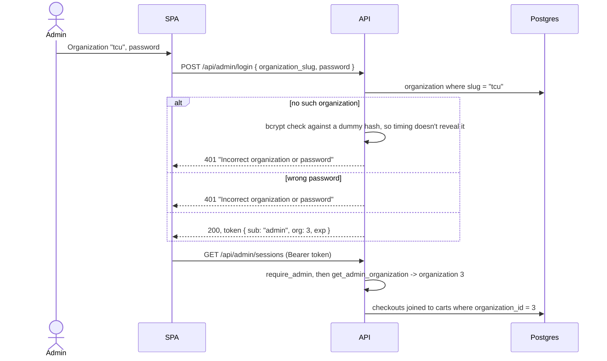
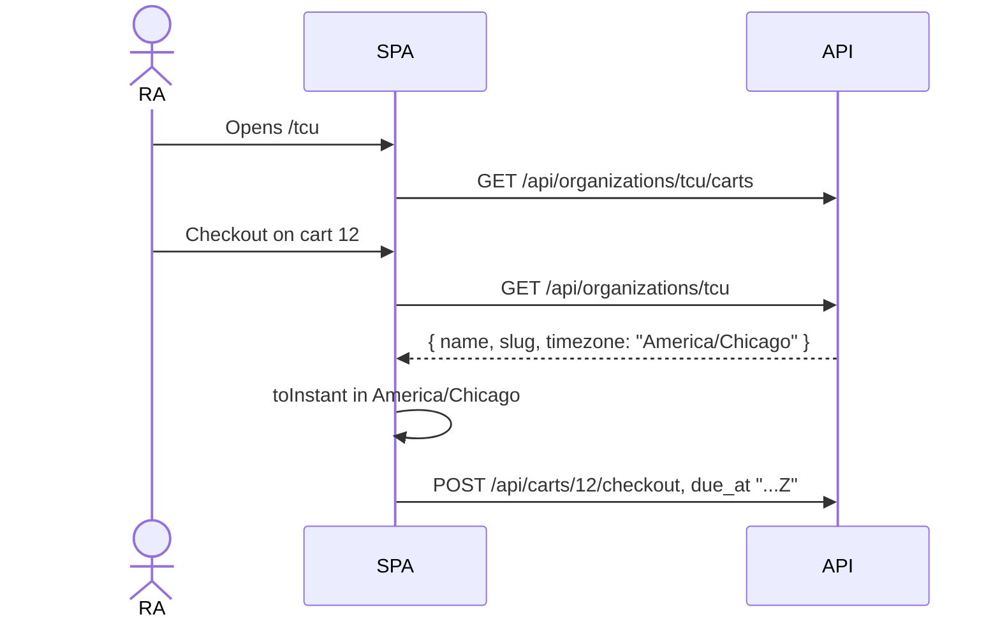
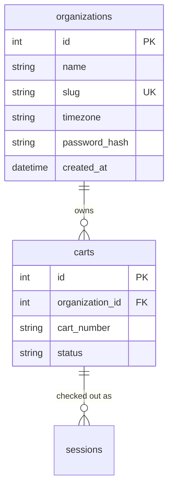

# Organizations design

**Area:** Organizations, timezone per organization, admin login per organization

> **Realizes:** `OI-6`, `OI-17`, `OI-18`; `BR-organization-owns-carts`, `BR-admin-own-organization`, `BR-admin-password-hashed`, `BR-organization-created-by-owner`, `BR-organization-link`
> **Depends on:** `BR-store-utc`, `BR-due-times-sent-as-instants`, `BR-desk-no-login`, `BR-cart-admin-only`
> **See:** [business rules](../requirements/business-rules.md), [architecture](architectural-design.md), [open issues](../requirements/OPEN-ISSUES.md)
> **Designed against:** `e61b2d9`

**Status:** Draft. Nobody builds from it until it is merged.

---

## Overview

The app serves one group of carts with one timezone and one shared admin password. This design
lets it serve many organizations at once, such as a college's move-in desk or a company that lends
carts. Each organization has its own carts, checkouts, timezone, and admin password, and never sees
another's.

- **Organizations are created by the owner** (the developer) with a command-line script, not from
  the website (`BR-organization-created-by-owner`).
- **The desk reaches its cart list through the organization's link**, such as `/tcu`. The desk still
  has no login (`BR-desk-no-login`, `BR-organization-link`).
- **An admin logs in with the organization's slug and its password** (`BR-admin-own-organization`).
- **Passwords are stored hashed in the database**, not in an environment variable, and an admin
  can change theirs from the admin page (`BR-admin-password-hashed`).
- **The timezone moves from the `settings` table onto the organization** (`OI-6`).

Out of scope: self-service signup, individual admin accounts, and the frontend redesign planned
after this. Screens keep today's plain styling.

## Components & classes

**Backend**

- `app/models.py`, `Organization` (**new**): `id`, `name`, `slug`, `timezone`, `password_hash`,
  `created_at`.
- `app/models.py`, `Cart` (**changed**): gains `organization_id`. `cart_number` is unique within an
  organization instead of across the app, so two colleges can both have cart "1".
- `app/models.py`, `Setting` (**removed**): its only row was the timezone.
- `app/auth.py` (**changed**): `hash_password` and `verify_password` use `bcrypt`.
  `create_access_token(organization_id)` puts the organization in the token as `org`. A new
  dependency, `get_admin_organization`, loads the token's organization and returns `401` if it no
  longer exists. `get_admin_password` and `ADMIN_PASSWORD` go away.
- `app/routers/organizations.py` (**new**, replaces `app/routers/settings.py`): the public
  `GET /api/organizations/{organization_slug}` and `GET /api/organizations/{organization_slug}/carts`.
- `app/routers/carts.py` (**changed**): `GET /api/carts` is removed, since it would list every
  organization's carts. Checkout and return keep their paths: a cart id already belongs to exactly
  one organization, and `to_utc()` reads that organization's timezone for any wall-clock text.
- `app/routers/admin.py` (**changed**): every handler takes `db_organization` from
  `get_admin_organization` and filters by it. A cart or checkout from another organization is `404`,
  the same as one that doesn't exist. New: `GET /api/admin/organization` and
  `PUT /api/admin/organization/password`. `PUT /api/admin/settings/timezone` keeps its path and
  writes `db_organization.timezone`.
- `app/create_organization.py` (**new**): `python -m app.create_organization`. Asks for name, slug,
  and timezone, reads the password with `getpass` (never echoed or saved), and stores only the hash.
  Run with `DATABASE_URL` pointing at Neon. A `--reset-password <slug>` flag covers an admin who
  forgets theirs.
- `app/timezones.py` (**changed**): `get_site_timezone(db)` becomes a read of
  `db_organization.timezone`. `DEFAULT_TIMEZONE` stays as the script's suggested default.

**Frontend**

- `App.jsx` (**changed**): `/:organizationSlug` shows `CartList`, and
  `/:organizationSlug/checkout/:cartId` shows `CheckoutForm`. `/` shows a short page asking for the
  organization's link. `/admin/login` and `/admin` stay.
- `CartList.jsx`, `CheckoutForm.jsx` (**changed**): read the slug from the URL and call the
  organization endpoints. An unknown slug shows the API's `detail`.
- `AdminLogin.jsx` (**changed**): an Organization field above the password. It remembers the last
  slug in `localStorage` (`organization_slug`) so the admin doesn't retype it.
- `AdminPage.jsx` (**changed**): shows the organization's name, and reads the timezone from
  `GET /api/admin/organization` instead of `/api/settings`.
- `AdminSettings.jsx` (**changed**): adds a Change Password form.

## Sequence

### Admin logs in

### Desk checks out a cart

## API contract

| Endpoint | Caller | Request | Success | Errors |
|---|---|---|---|---|
| `GET /api/organizations/{organization_slug}` | Public | | `200`: `OrganizationResponse` `{ name, slug, timezone }` | Unknown slug: `404` "Organization not found" |
| `GET /api/organizations/{organization_slug}/carts` | Public | | `200`: that organization's carts, as today's `GET /api/carts` | Unknown slug: `404` "Organization not found" |
| `POST /api/admin/login` | Public | `AdminLogin` `{ organization_slug, password }` | `200`: `TokenResponse` | Unknown slug or wrong password: `401` "Incorrect organization or password" |
| `GET /api/admin/organization` | Admin token | | `200`: `OrganizationResponse` | No, expired, or orphaned token: `401` |
| `PUT /api/admin/organization/password` | Admin token | `PasswordUpdate` `{ current_password, new_password }` | `204` | Wrong current password: `400` "Current password is incorrect". New one under 12 characters: `422`. |
| `PUT /api/admin/settings/timezone` | Admin token | unchanged | `200`: `SettingsResponse` for this organization | unchanged |
| Every other `/api/admin/...` route | Admin token | unchanged | Only this organization's carts and checkouts | Another organization's cart or checkout: `404`, same text as a missing one |
| `GET /api/carts`, `GET /api/settings` | | | **Removed** | `404` |

`POST /api/admin/carts` checks `cart_number` for duplicates only within the admin's organization.

## Key decisions

**One password per organization, not admin accounts.** Chosen by the owner on 2026-10-15
(`OI-18`). It keeps today's model, a small team sharing one login, while separating organizations.
Rejected: individual accounts, which bring signup, password reset by email, and roles. Rejected: an
external login service, a new dependency and cost for a handful of admins.

**Passwords hashed with `bcrypt`, in the database.** Chosen by the owner on 2026-10-15 (`OI-18`).
An admin can change the password without anyone editing Render's environment, and a leaked database
reveals no passwords. `bcrypt` is one small, maintained package. Rejected: `passlib`, which is no
longer maintained. `ADMIN_JWT_SECRET` stays in Render's environment: it signs tokens and isn't a
password anyone types.

**The owner creates organizations with a script, not a web page.** Chosen by the owner on
2026-10-15. A script needs no super-admin login, which would bring back a password held outside the
database. The script stores only the hash. Rejected: a super-admin page, a second kind of login to
build and protect for something done a few times a year.

**The slug is in the URL, and the slug is not a secret.** `/tcu` is bookmarked at the desk
(`BR-organization-link`). Anyone who learns it can use that desk's cart list, which is today's
`RISK-open-desk-api` scoped to one organization. Rejected: a desk code (an extra step at a busy desk)
and a desk login (the same, plus passwords for every RA).

**The login form takes a typed slug, not a dropdown.** A dropdown needs a public list of every
organization, which tells anyone who the customers are.

**Checkout and return keep their paths.** The cart id already says which organization the cart is
in. Rejected: `/api/organizations/{organization_slug}/carts/{cart_id}/checkout`, which repeats what
the id already says and changes two endpoints for no new rule.

**Another organization's data is `404`, not `403`.** A `403` would confirm the cart exists.

**The organization is on the cart, not on the checkout.** A checkout reaches its organization
through `cart_id`, and admin queries already join `carts` to get the cart number. This leaves
`OI-10` open: a checkout still doesn't record the timezone it was made in.

## Data model

- `slug`: lowercase letters, digits, and hyphens, 2 to 40 characters, unique. `admin` and `api` are
  reserved because they are paths in the SPA or API.
- `carts`: unique on `(organization_id, cart_number)`, replacing the unique index on `cart_number`.
- `settings`: dropped.

**Manual change on Neon.** `create_all` makes the `organizations` table but doesn't change `carts`
(see `CLAUDE.md`). In order, before the new API deploys:

1. Run `python -m app.create_organization` against Neon for the organization that keeps the
   existing data (`OI-19`). Use the timezone currently in `settings`.
2. In one transaction: add `carts.organization_id` referencing `organizations(id)`, set it to that
   organization's id for every row, make it `NOT NULL`, drop the index `ix_carts_cart_number`,
   create a unique index on `(organization_id, cart_number)`, and drop `settings`.
3. Deploy the API, then the frontend. Between the two, the old frontend calls the removed
   `GET /api/carts` and shows no carts, so deploy when no desk is open.
4. Remove `ADMIN_PASSWORD` from Render.

The exact SQL goes in the pull request that builds this, tested first on a local Postgres.

## Reuse & cross-cutting

- `require_admin` stays on the whole admin router ([8.1](architectural-design.md#81-security)).
  `get_admin_organization` builds on it, so a route can't forget to check the token.
- `toInstant()` and `formatTime()` take the organization's timezone where they took the site's.
- API errors follow `CLAUDE.md`; the frontend shows `detail` on the login and password forms.

## Tests

`conftest.py` gains an `organization` fixture that creates an organization with a known password,
and `admin_headers` logs in to it. A second fixture, `other_organization`, exists for isolation
tests.

| Flow | Level | Asserts |
|---|---|---|
| Login | integration | Right slug and password: `200` with a token carrying `org` |
| Login, wrong password | integration | `401` "Incorrect organization or password" |
| Login, unknown slug | integration | `401`, same `detail` as a wrong password |
| Isolation, lists | integration | An admin of one organization sees none of another's carts or checkouts |
| Isolation, writes | integration | Editing, deleting, force-returning, or changing the due time of another organization's cart or checkout: `404` |
| Cart numbers | integration | Two organizations can both create cart "1"; one organization can't create it twice |
| Public cart list | integration | `GET /api/organizations/{slug}/carts` returns only that organization's carts; unknown slug: `404` |
| Timezone | integration | Wall-clock checkout text is read in the cart's organization's timezone; changing one organization's timezone doesn't change another's |
| Password change | integration | Right current password: `204`, and the new one logs in while the old one doesn't. Wrong current password: `400`. Short new one: `422`. |
| Orphaned token | integration | A token whose organization was deleted: `401` |
| Hashing | unit | `hash_password` never returns the password; `verify_password` accepts the right one and rejects others |
| Script | unit | `create_organization` refuses a reserved or duplicate slug and an unknown timezone |

The frontend has no automated tests. Checked by hand: log in to two organizations in two browsers,
and each sees only its own carts and timezone.

## Changes to the architecture-of-record

- 3 and 5.1: the desk's entry point becomes the organization link.
- 5.2: an Organizations component replaces Settings and time; Auth depends on it.
- 8.1: authentication per organization; `ADMIN_PASSWORD` leaves the secrets list.
- 9.2: `KD-shared-admin-password` is superseded by a new `KD-organization-password`; `KD-utc-storage`
  loses its one-timezone trade-off.
- 11: `TD-single-site-timezone` is removed. `RISK-open-desk-api` is scoped to one organization.
- Glossary: Admin, Site timezone, and Cart number change; Organization, Organization slug, and Owner
  are added.

## Open questions & risks

- `OI-19`: which organization the existing data on Neon belongs to, or whether to start empty.
- `OI-10`: a checkout still doesn't record its timezone.
- Risk: a forgotten password needs the owner to run the script. Fine for a few organizations.
- Risk: login has no rate limit, so a password can be guessed online. bcrypt slows each guess, and
  the 12-character minimum makes guessing impractical. Revisit if an organization uses a weak one.
- Deploy order: Neon first, then the API, then the frontend (see [Data model](#data-model)).
